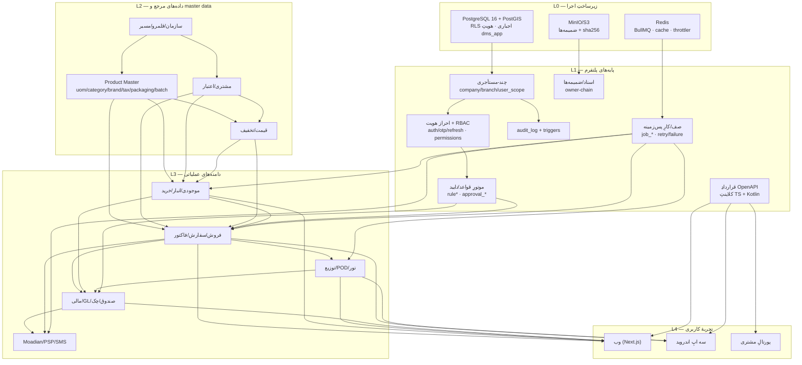
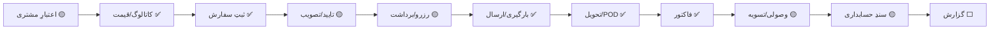

# نقشهٔ وابستگی و معماری — Gate 1 (TASK-21)

> هدف: مدلِ معنادارِ وابستگی (نه فهرستِ ماژول‌ها) برای تصمیمِ توالیِ Gate 2. هر رابطه با شاهد (FK/جدول/endpoint/تست) همراه است.

## ۱) لایه‌بندیِ پایه‌های مشترک

## ۲) ماتریسِ وابستگیِ ماژول‌ها

| ماژول/دامنه | مالکیتِ دامنه | شناسه‌های هسته | بالادست (پیش‌نیاز) | پایین‌دست (مصرف‌کننده) | وابستگیِ مشترک | ریسکِ سازگاری/مهاجرت |
|---|---|---|---|---|---|---|
| سازمان/مستأجر (A) | platform | company_id, branch_id | — | همه | TEN, RLS | تغییرِ scoping = مهاجرتِ حساس |
| کاربر/نقش/مجوز (B) | platform | user_id, role_id, permission | A | همه | AUTH, user_scope | — |
| Product Master (C) | master-data | product_id, uom_id, packaging_id | A | D,E,F,G,H,I,J,M | tax_code, attachment('product') | تغییرِ نام/واحد نباید تاریخچه را بازنویسی کند (§۸) |
| مشتری/اعتبار (D) | sales-adjacent | customer_id, customer_credit | A | E,F,H,I | person, geofence | — |
| قیمت/تخفیف (E) | pricing | price_list_id, promotion_id | C,D | F (snapshot در خط) | rules-engine (تاییدها) | تغییرِ engine نباید اسنادِ گذشته را تغییر دهد |
| سفارش/فروش (F) | sales | sales_order_id, invoice_id | C,D,E, G(موجودی), B | H,I,J,M | RULES (approval), QUEUE | وضعیت‌های چرخه در check constraint — مهاجرت برای تغییر |
| موجودی/انبار (G) | inventory | inventory_txn, stock_balance, batch | C, A | F,H,I | QUEUE | صحتِ تراز = منبعِ حقیقتِ موجودی؛ تعارض با stock_valuation ممنوع |
| خرید/تدارکات (G2) | purchasing | purchase_order_id, goods_receipt | C,G | I (payable) | approval (PO) | — |
| توزیع/POD (H) | distribution | delivery_id, pod_id, tour_id | F,G | I (وصولی), M | DOC (POD attachments), tracking | زنجیرهٔ مالکیتِ pod→delivery→branch (TASK-14) نباید شکسته شود |
| مالی/GL (I) | finance | journal_entry, gl_account | F,G,H | J,M | fiscal_period, account_mapping | اسنادِ حسابداری نامتغیر؛ reversal کنترل‌شده |
| Moadian/یکپارچه‌سازی (J) | integrations | moadian_submission, webhook | I,F | خارج | QUEUE (retry), integration_credential | سازگاریِ قراردادِ بیرونی |
| موبایل (K) | field-force | client_sync_receipt | قرارداد, F,D,H | — | CONTRACT, offline cache | نسخهٔ API باید با کلاینتِ تولیدی همگام بماند |
| اعلان/سند/وظیفه (L) | platform-cross | — | QUEUE, DOC | همه (آینده) | — | **مرزِ معماریِ گمشده** (G-05) |
| گزارش/BI (M) | analytics | ledger_balance_snapshot, ar_aging | I,F,G | — | — | گزارش‌ها باید با اسنادِ مبدأ reconcile شوند |

## ۳) جریان‌های canonical (§۹ نقشهٔ راه) — بلوغِ گام‌ها

وضعیت‌ها: ✅ پیاده‌سازی‌شده/تاییدشده · 🟡 جزئی · ❌ گمشده · ⬜ اثبات‌نشده (UNVERIFIED).

### ۳-۱) Order-to-Cash

| گام | وضعیت | شاهد/شکاف |
|---|---|---|
| اعتبار/سقف | 🟡 | `customer_credit` هست؛ اعمالِ قواعد در ثبتِ سفارش بدونِ تستِ اختصاصی |
| قیمت/کاتالوگ | ✅ | price_list/customer_price + snapshot در خط |
| سفارش | ✅ | `sales_order` + چرخهٔ وضعیت + `orders.api.test.ts` |
| تصویب | 🟡 | approval_* + rules-engine بدونِ تستِ رفتاری (G-03) |
| رزرو/برداشت | 🟡 | `stock_reservation` هست؛ picking نیست (G-12) |
| بارگیری/تحویل/POD | ✅ | vehicle_load/delivery/pod + ۹ تستِ ضمیمه |
| فاکتور | ✅ | invoice/credit_note + billing |
| وصولی | 🟡 | receipt/allocation/cheque/cash؛ موبایل ⬜ |
| حسابداری | 🟡 | journal/account_mapping؛ قواعدِ خودکارِ رویداد جزئی |
| گزارش | ⬜ | گزارش‌ها هستند؛ reconcile با مبدأ `UNVERIFIED` |

### ۳-۲) Procure-to-Stock

نکته: backend این جریان از پُرترین بخش‌هاست (۱۶ مسیر + ۲ فایلِ تست) اما **UI ندارد** (G-09) و تاییدِ PO/تسویهٔ تامین‌کننده ناقص‌اند.

### ۳-۳) Return-to-Resolution
| گام | وضعیت | شاهد/شکاف |
|---|---|---|
| درخواست/دلیل | ✅ | `return_request(+line)` + `returns.api.test.ts` |
| مجوز/بازرسی | 🟡 | تاییدها وابسته به G-03 |
| بازگشت به قفسه/قرنطینه/اسقاط | 🟡 | inventory_txn با kind های مربوط؛ گردشِ کاملِ UI ⬜ |
| credit note/جایگزین | 🟡 | `credit_note(+line)` ✅ در مالی |
| تحلیل | ❌ | گزارشِ اختصاصیِ مرجوعی نیست |

### ۳-۴) Route-to-Delivery
| گام | وضعیت |
|---|---|
| قلمرو/برنامهٔ بازدید | 🟡 (route/visit/route_plan هست؛ بهینه‌سازی ساده) |
| مسیر/خودرو/بار | ✅ (vehicle/vehicle_load/waybill) |
| اجرای مسیر/GPS | ✅ (tracking/geofence) |
| POD یا شکست با کدِ دلیل | ✅ (pod + delivery_line) |
| وصولی/تحویل به صندوق | 🟡 |
| مغایرت | 🟡 (daily_treasury_close) |

### ۳-۵) Promotion-to-Settlement
| گام | وضعیت |
|---|---|
| قواعدِ کمپین | 🟡 (promotion ۹ نوع؛ engine بدونِ تستِ رفتاری) |
| eligibility/قیمت‌گذاریِ سفارش | 🟡 (promotion_id در خط) |
| جایزه/تخفیف | 🟡 |
| تصویب | 🟡 |
| تسویه با تامین‌کننده/سازنده | ❌ (G-04) |
| تحلیلِ اثربخشی | ❌ |

### ۳-۶) Period Close
| گام | وضعیت |
|---|---|
| اعتبارسنجیِ زیردفترها | 🟡 (ledger_balance_snapshot) |
| مغایرت | 🟡 |
| بازبینیِ اسناد | 🟡 (journal + تایید) |
| بستنِ دوره | 🟡 (`gl.period.close` + fiscal_period) |
| صورت‌های مالی/ممیزی | ❌/🟡 (گزارش‌های پایه؛ صورتِ استاندارد نیست) |

## ۴) مسایلِ معماری، چرخه‌ها و مرزهای گمشده

1. **چرخهٔ واقعی یافت نشد.** وابستگی‌ها عموماً به‌صورت DAG از L2 به L3 به L4 هستند. تنها کوپلینگِ دوطرفهٔ ظاهری `promotion ↔ sales_order_line` (FK + منشأِ تخفیف) است که قابلِ قبول و عمداً برای رهگیری طراحی شده.
2. **مرزِ گمشده: مرکزِ اعلان (L-01).** اکنون OTP/SMS درونِ identity-rbac جاسازی شده؛ با ورودِ جریان‌های کاری (تاییدها، تحویل، مطالبات) نیاز به bounded context مستقلِ «notification» با قالب/ترجیح/وضعیتِ تحویل/تلاشِ مجدد است (G-05). **پیشنهاد: ماژولِ جدیدِ مستقل** در نخستین نقطه‌ای که دومین مصرف‌کننده ظاهر شود.
3. **مرزِ گمشده: مرکزِ import/export (L-05).** منطقِ validation/preview/error-report نباید در ماژول‌های پراکنده تکرار شود.
4. **باید درونِ context موجود بماند (جداسازیِ بی‌دلیل ممنوع):** approvals درونِ rules-engine («workflow & rules») یک context واحد است؛ POD درونِ distribution؛ batch درونِ inventory؛ credit درونِ customer/sales-adjacent.
5. **جداسازیِ توجیه‌پذیرِ آینده:** «pricing engine» اگر قواعدِ cascade/margin/simulation اضافه شود، مرزِ روشنی از master-data دارد (مالکیتِ E در ماتریس).
6. **گلوگاه‌ها:** (الف) قراردادِ OpenAPI = نقطهٔ واحدِ شکست برای وب/موبایل/پورتال (تغییرِ آن همه‌جا را می‌شکند — حفاظتِ contract-drift لازم است)؛ (ب) `inventory_txn` = منبعِ حقیقتِ موجودی برای فروش/مالی/BI؛ (ج) owner-scopeِ ضمیمه‌ها = الگوی مالکیتی که هر feature جدیدِ فایل باید از آن بگذرد.
7. **ریسکِ منبعِ حقیقتِ دوگانه:** `stock_balance` در برابرِ جمعِ `inventory_txn`، و `ledger_balance_snapshot` در برابرِ جمعِ `journal_line` — هر دو «کشِ تراز» هستند؛ باید همیشه از مبدأ قابلِ بازسازی باشند (در P5 تستِ تطابق لازم است).
8. **وابستگی‌های عملیاتی:** Redis برای صف (بدونِ آن graceful degrade)، S3 برای ضمیمه، درگاه‌های خارجی (SMS/Moadian/PSP) با mock در دسترس‌اند؛ production بدونِ آن‌ها fail-closed است (اثبات‌شده در TASK-19).

## ۵) نتیجه‌گیریِ وابستگی برای توالی

- **هیچ مانعِ معماریِ جلویِ Product Master نیست** (همهٔ بالادست‌هایش L1/L2 ✅‌اند).
- سه وابستگیِ cross-cutting که **نباید به انتها موکول شوند** (قاعدهٔ §۷ نقشهٔ راه): تستِ رفتاریِ rules/approval (G-03، پیش‌نیازِ روانِ P3-P4)، مرکزِ اعلان (G-05، حداکثر تا P4)، و پایهٔ import انبوه (G-13، پیش‌نیازِ P1 به‌شکلِ محدود).
