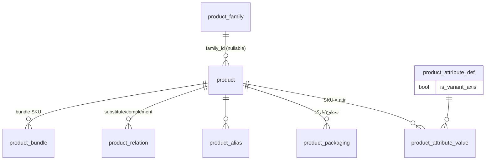

# طراحیِ هدفِ Product Master — پیش‌طراحیِ معماری (TASK-21R)

> وضعیت: **طرحِ پیشنهادی برای تأییدِ مالک** — هیچ کد/مهاجرتی در این وظیفه اجرا نمی‌شود.
> مرجعِ دامنه: `PRODUCT_ROADMAP.md` §6-A و §۸ (۱۴ بند) — **دامنه حذف یا باریک نمی‌شود**؛ این سند فقط نحوهٔ تحقق را معین می‌کند.
> پیوستگی: `IMPLEMENTATION_SEQUENCE.md` (فازِ P1) · `GAP_REGISTER.md` (شکاف‌های G-06/G-07/G-13/G-03) · `MODULE_INVENTORY.md` (C-01..C-12).

## ۰) نتیجهٔ آمادگی (دقیق) و تصمیماتِ واقعیِ مالک

| لایه | نتیجه |
|---|---|
| **معماری/طراحی** | **`READY`** — بنیادها راستی‌آزمایی شده، دامنه شناخته‌شده، همین سند مدلِ هدف را می‌بندد (یافته‌های TASK-21Q در همین سند آشتی شد — پیوستِ انتهایی). |
| **پیاده‌سازی** | **`CONDITIONAL READY`** — بدونِ مانعِ خارجی؛ مشروط به (۱) تأییدِ نهاییِ همین طرح توسط مالک؛ (۲) مصوباتِ D1–D5 (همین‌جا ثبت شد)؛ (۳) سبز شدنِ بستهٔ تستِ رفتاریِ موتورِ تایید (G-03) **پیش از** سیم‌کشیِ «تغییراتِ حساس» به approval (پیش از آن، تغییراتِ حساس با RBAC + تأییدِ صریح + audit اداره می‌شوند). |

**مصوباتِ مالک (ثبت‌شده در TASK-21S — لازم‌الاجرا در پیاده‌سازی):**

| # | تصمیمِ مصوب |
|---|---|
| **D1 (مصوب)** | پشتیبانیِ هم‌زمان از کدِ SKU دستی و تولیدِ خودکار. |
| **D2 (مصوب)** | تکرارِ کدِ محصول ممنوع است. یکتاییِ بارکد باید میانِ **انواعِ استانداردِ دارایِ حاکمیتِ جهانی** و **بارکدهای داخلیِ scope-شده به شرکت** تمایز بگذارد. نام‌های مشابهِ محصول = **هشدار**، نه مانعِ سخت. |
| **D3 (مصوب)** | دقتِ تبدیلِ مقدار = چهار رقمِ اعشار. **رفتارِ دقیقِ گردکردنِ مالیِ موجود و قراردادهای پیاده‌سازی‌اش عیناً حفظ می‌شود**؛ نه قاعدهٔ عمومیِ half-up، نه تغییرِ بی‌صدای رفتارِ مقادیرِ منفی. الزامِ تستِ رگرسیون برای مبالغِ مثبت و منفی. |
| **D4 (مصوب)** | تغییراتِ حساس: فیلدهای مالیاتی، وضعیت/توقفِ محصول، واحدِ پایه، فاکتورِ تبدیل، اجزای bundle. اعمالِ کنترل‌ها **در مرزِ نوشتنِ service/domain** روی همهٔ مسیرهای نوشتن. |
| **D5 (مصوب)** | P1 فقط ترکیبِ کاتالوگیِ bundle را تعریف و نمایش می‌دهد. تا طراحی و پیاده‌سازیِ کاملِ semantics عملیاتی در P5، محصولاتِ bundle **نباید قابلِ سفارش/فروش باشند یا در حرکت‌های موجودی شرکت کنند.** |

بقیهٔ مواردِ §۸ (attributes، variants، alias، تصویر، جایگزین/مکمل، import، snapshot) **طبقِ نقشهٔ راه الزامی‌اند** و تصمیمِ دامنه‌ای نمی‌خواهند — فقط semantics آن‌ها در این سند تعیین شده است.

---

## A. هویتِ محصول و کاتالوگ

| موضوع | تصمیمِ هدف | وضعیتِ امروز |
|---|---|---|
| دامنهٔ tenant | `product.company_id` حفظ می‌شود؛ SKU در `(company_id, code)` یکتا (موجود). دامنهٔ شعبه‌ای برای کاتالوگ **خارج از scope** (قیمت/موجودی شعبه‌ای است، نه تعریفِ کالا). | ✅ موجود |
| چرخهٔ SKU | `status ∈ {active, blocked, discontinued}` + `deleted_at` نرم؛ **حذفِ فیزیکی ممنوق وقتی ارجاعِ سند/موجودی/قیمت وجود دارد**؛ گذارِ blocked→active با مجوزِ `product.status`؛ discontinued برگشت‌پذیر نیست مگر با `product.status` (ممتاز). | ✅ موجود (قواعدِ گذار جدید) |
| نامِ فارسی/لاتین | `name` (فارسی، موجود) + `name_latin` (جدید، nullable) + `name_display` مشتق نشود — نمایش: فارسی، fallback لاتین. | 🟡 نیمه |
| alias و تشخیصِ تکرار | جدولِ جدید `product_alias(id, product_id, alias, alias_norm, kind ∈ {brand_slang, latin, code}, unique(product_id, alias_norm))` + GIN-trgm روی `alias_norm`؛ تشخیصِ تکرار هنگامِ create/import روی نرمال‌سازیِ (نام، alias، کد، بارکد) — طبقِ D2. | ❌ جدید |
| گروه/برند | موجود (سلسله‌مراتبِ `parent_id` + `cost_method`) — بدونِ تغییر. | ✅ |
| attribute/variant | مدلِ §B. | ❌ جدید |
| تصویر/سند | بازاستفاده از `attachment.owner_type='product'` (زنجیرهٔ مالکیت موجود). قراردادِ تصویرِ اصلی = نخستین بر اساس `created_at` (بدونِ مهاجرت)؛ در صورتِ نیازِ UI، بعداً `sort_order` اضافه شود. | 🟡 API موجود، UX ندارد |
| جایگزین/مکمل | `product_relation(product_id, related_id, kind ∈ {substitute, complement}, priority, unique(product_id, related_id, kind))`؛ خودارجاع ممنوع؛ حلقه در سطحِ substitute در service رد می‌شود. | ❌ جدید |
| bundle | **فقط کاتالوگی در P1 (D5 مصوب):** `product_bundle(bundle_product_id, component_product_id, qty)` — ترکیبِ تعریف/نمایش‌داده می‌شود؛ **SKU بسته تا تکمیلِ P5 نباید قابلِ سفارش/فروش باشد یا در حرکت‌های موجودی شرکت کند** (در service ردِ صریح + در UI غیرفعال/برچسب‌دار). **semantics عملیاتی (expansion، رزرو، تحویل، مرجوعی، بچ/انقضا، COGS) منحصراً در P5** — فهرستِ تصمیمات و سناریوها در §A-بندِ «B-P5» زیر. | ❌ جدید (کاتالوگ در P1؛ عملیاتی در P5) |

## B. معماریِ Variant و SKU (تصمیمِ محوری)

### ارزیابی
- **صفتِ توصیفی (descriptive attribute):** ویژگیِ اطلاع‌رسان (رنگِ بسته، ارتفاع، نوعِ عرضه) که **قیمت/موجودی/مالیات/بارکد مستقل ندارد** — نباید SKU بسازد.
- **variant عملیاتی (operational variant):** ترکیبی که **قیمت، موجودی، بارکد یا مالیاتِ مستقل** دارد (مثلاً طعم/حجم) — در DMS مویرگی تقریباً همیشه صادق است ⇒ **هر variant عملیاتی = یک SKU مستقل**.

### مدلِ پیشنهادی: «SKU-per-variant با خانوادهٔ اختیاری»

- `product` **همچنان تنها هویتِ SKU است** (همهٔ FKهای موجود: `inventory_txn.product_id`، `sales_order_line.product_id`، `price_list_item.product_id`، `batch.product_id` — **بدونِ هیچ مهاجرتِ داده‌ای**).
- `product_family` = گروهِ اختیاری (مثلاً «شیر پرچرب ۱ لیتری»)؛ ستونِ `product.family_id nullable` — ردیف‌های موجود = SKUهای مستقلِ بدونِ خانواده (سازگاریِ کامل).
- `product_attribute_def(company_id, code, title, kind ∈ {text, number, enum}, is_variant_axis, is_required)` + `product_attribute_value(product_id, def_id, value_text/value_num/value_enum)`.
- **variant_signature**: هشِ مرتبِ مقادیرِ صفاتِ `is_variant_axis` در هر خانواده؛ `unique(family_id, variant_signature)` (partial) — تشخیصِ تکرارِ variant.
- **چه زمانی variant = SKU مستقل؟** همیشه وقتی یکی از {قیمت، موجودی، بارکد، مالیات، چرخهٔ مستقل} متفاوت باشد؛ برای صفاتِ صرفاً توصیفی، attribute کافی است و SKU اضافه ساخته نمی‌شود.
- **بارکد (بازطراحی‌شده پس از TASK-21Q — H-1):** مدلِ اختصاصیِ `product_barcode`:

```sql
-- طرحِ هدف (مستند — مهاجرت در P1 نوشته می‌شود):
create table product_barcode (
  id           uuid primary key default gen_random_uuid(),
  company_id   uuid not null references company(id),   -- مالکیتِ tenant — حتی برای بارکدِ جهانی
  product_id   uuid not null references product(id),
  packaging_id uuid references product_packaging(id),  -- اختیاری: سطحِ بسته‌بندی
  barcode      text not null,
  kind         text not null check (kind in ('gs1_ean13','gs1_ean8','gs1_upc','gs1_itf14','internal','other')),
  is_primary   boolean not null default false,
  created_at   timestamptz not null default now()
);
```
  - **یکتاییِ نوع‌محور (D2):** برای انواعِ استانداردِ جهانی (`gs1_*`) ایندکسِ یکتای **جهانی** روی `barcode`؛ برای `internal`/`other` ایندکسِ یکتای **`(company_id, barcode)`**. هر دو `create unique index` ⇒ حفاظتِ هم‌زمانی (race) در سطحِ DB، بدونِ نیاز به قفلِ برنامه‌ای.
  - **مالکیت/جداسازیِ tenant:** `company_id` صریح روی هر ردیف؛ خوانش‌ها همیشه با filter شرکت (به‌جز resolution جهانیِ gs1 که cross-tenant عمداً یکتاست)؛ import هرگز company را از CSV نمی‌گیرد.
  - **جلوگیری از برخوردِ سراسریِ look-up:** نرمال‌سازیِ مقدارِ بارکد (trim، ارقامِ فارسی→لاتین، بدونِ فاصله) قبل از ثبت؛ یکتاییِ `(product_id, barcode)`؛ ممنوعیتِ هم‌ارزیِ بارکد با `product.code` و `product_alias` (بررسیِ service در create/import + تستِ همزیستی) تا resolution اسکن **تک‌معنا** بماند.
  - **چند بارکدی:** برای هر SKU و هر سطحِ packaging چند ردیف (برخلافِ `uq_product_packaging` قدیمی)؛ `is_primary` فقط یکی در هر `packaging_id` (unique partial).
  - **resolution قطعیِ اسکن:** ترتیبِ lookup = (۱) `product_barcode` (match صریحِ نرمال‌شده) ← (۲) `product.code` ← (۳) `product_alias.kind='code'`؛ در برخوردِ چندپاسخی = خطای صریحِ فارسی (هرگز انتخابِ خودسرانه).
  - **وضعیتِ قیدهای قدیمی:** `uq_product_packaging` و `uq_product_barcode` (0005:85,88) **این طرح را پشتیبانی نمی‌کنند** (اولی یک ردیف در هر (product,uom)؛ دومی جهانیِ بدونِ نوع/tenant). مهاجرتِ P1: ایجادِ `product_barcode` + انتقالِ بارکدهای موجود از `product_packaging.barcode` (کپی، بدونِ حذفِ ستون تا P5) + متروک‌سازیِ تدریجیِ دو قیدِ قدیمی پس از تخلیهٔ مصرف.
- **سطحِ قیمت/موجودی/مالیات/خطِ سفارش:** همه در **سطحِ SKU** (`product_id`) — هم‌راستا با schema موجود؛ قیمتِ سطحِ خانواده (اگر روزی لازم شد) فقط به‌صورتِ قاعدهٔ مشتق، نه منبعِ حقیقت.
- **سازگاریِ عقب‌رو:** هیچ داده‌ای جابه‌جا نمی‌شود؛ endpointهای فعلیِ product دست‌نمی‌خورند؛ همه چیز additive.

### جایگزین‌ها و trade-offها
| مدل | مزیت | هزینه/ریسک | داوری |
|---|---|---|---|
| **A. SKU-per-variant + خانواده (پیشنهادی)** | سازگار با تمامِ FKها؛ قیمت/موجودی/مالیات ساده و یکتا | تعدادِ ردیف‌های product بیشتر (قابلِ قبول) | ✅ |
| B. یک SKU + انتخابِ صفت روی خطِ سفارش | ردیفِ کمتر | **شکستنِ FKهای موجود**؛ موجودی/قیمت/مالیات per-combo پیچیده؛ کوئری‌های سنگین | ❌ |
| C. SKU-per-variant بدونِ خانواده | ساده‌ترین | نمایشِ ماتریسی/جست‌وجوی خانواده‌ای ناممکن | 🟡 (fallback اگر D1 ساده خواسته شود) |

### پیامدهای مهاجرت/ایندکس
- جداولِ جدید: `product_alias`, `product_attribute_def`, `product_attribute_value`, `product_relation`, `product_bundle` (+ در صورتِ پذیرشِ مدلِ A، ستونِ `product.family_id` و `variant_signature`).
- ایندکس‌ها: GIN-trgm روی `alias_norm`؛ `unique(family_id, variant_signature)`؛ `unique(company_id, code)` موجود دست‌نخورده.
- حجم: جداولِ attribute در جدول‌های متعارفِ EAV-lite برای مقیاسِ هزار SKU (نه میلیونی) کافی‌اند؛ در صورتِ رشد، بعداً index tuning — نه اکنون.

### B-P5 — semantics عملیاتیِ bundle (منحصراً P5 — پس از طراحی و تست)

**P1 فقط ترکیبِ کاتالوگی است.** ممنوعیت‌های صریحِ P1 (D5): خطِ سفارش/فاکتور روی SKU بسته **رد می‌شود**؛ هیچ posting/رزرو/انتقالِ موجودی برای بسته یا اجزایش از مسیرِ bundle انجام نمی‌شود؛ UI سفارش‌دهیِ بسته را غیرفعال می‌کند.

**تصمیماتِ طراحیِ الزامیِ P5 (پیش از کد):**
1. زمان‌بندیِ رزرو/کسرِ اجزا (سفارش ↔ تحویل ↔ فاکتور) و رفتارِ «موجودیِ ناکافیِ جزء».
2. تحویلِ جزئی و لغو: معکوس‌سازیِ حرکت‌های expanded و اثر بر رزرو.
3. مرجوعی: بازگشتِ bundle به اجزا (یا بالعکس) + ردیابیِ جزء-سطحی.
4. انتخابِ بچ/انقضای اجزا (FEFO/FIFO) و ثبتِ batch در حرکت‌ها.
5. COGS: گردشِ بهای بسته از بهای اجزا (cost_layer/`qty_on_hand_value`) و قیمتِ فروشِ بسته.
6. سازگاری با `inventory_txn`/`stock_balance` (اجزا = منبعِ حقیقت؛ بسته = مجازی) + چکِ موجودیِ خطِ بسته.

**سناریوهای رگرسیونِ الزامیِ P5:** فروشِ کامل/جزئیِ بسته؛ لغو پس از رزرو؛ مرجوعیِ کامل/جزئی؛ بچِ منقضی‌شده در جزء؛ تغییرِ ترکیبِ بسته پس از فروش (نباید تاریخچه را بازنویسی کند)؛ تطابقِ COGS با مجموعِ اجزا؛ ممنوعیتِ فروشِ بستهٔ دارایِ جزءِ متوقف.

## B2. هویتِ variant — قواعدِ قطعی (آشتیِ TASK-21Q — M-3)

**نرمال‌سازیِ مقدار (پیش از امضا):** Unicode NFC؛ trim فاصله‌های ابتدا/انتها و فشردنِ فاصله‌های داخلی به یک space؛ ارقامِ فارسی/عربی → لاتین؛ casefold برای بخشِ لاتین؛ عدد: نمایشِ canonیک با حذفِ صفرهای انتهاییِ بی‌معنی (`1.50` → `1.5`)؛ مقدارِ NULL/غایب: توکنِ صریحِ `∅` (هرگز حذفِ محور از امضا).
**تولیدِ امضا:** مرتب‌سازیِ قطعی بر اساسِ `def_id`؛ جفت‌های `def_id=value_norm` با جداکنندهٔ غیرقابلِ برخورد؛ `variant_signature = sha256(canonical_string)` (الگوریتمِ ثابت؛ هرگز تابعِ hash داخلیِ زبان).
**قید:** `create unique index ... on product (family_id, variant_signature) where variant_signature is not null` — حفاظتِ هم‌زمانی در سطحِ DB؛ SKUهای بدونِ خانواده (family_id NULL) خارج از قید.
**تغییرناپذیری:** پس از نخستینِ ارجاعِ عملیاتی (سند/موجودی/قیمت)، `variant_signature` و محورهای آن **تغییرناپذیرند**؛ تغییرِ محور ⇒ SKU جدید + بازنشستگیِ SKU قبلی — هرگز بازنویسیِ هویت.

## B3. اعتبارسنجیِ attribute (آشتیِ TASK-21Q — L-1)

- `product_attribute_def.kind ∈ {text, number, enum}`؛ برای `enum`: دامنهٔ مقادیر در `product_attribute_enum_value(def_id, value)` (جدولِ فرزند) + CHECK در service.
- `product_attribute_value`: `unique(product_id, def_id)`؛ CHECK هم‌راستاییِ ستونِ مقدار با kind (value_text برای text/enum، value_num برای number)؛ الزامِ `is_required` هنگامِ ثبتِ SKU.
- نرمال‌سازیِ مقدارِ enum با همان قواعدِ B2 (برای امضای پایدار).

## B4. تصویرِ اصلی (آشتیِ TASK-21Q — L-2)

قراردادِ v1: نخستینِ attachment بر اساسِ `created_at` = تصویرِ اصلی. **محدودیتِ مستند:** حذفِ آن، بی‌صدا تصویرِ بعدی را اصلی می‌کند؛ برای کنترلِ صریح در نسخه‌های بعدی `sort_order`/`is_primary` به attachment افزوده می‌شود — تا آن زمان UI این رفتار را به‌شکلِ «اصلی (خودکار)» نشان دهد.

## C. واحدها و بسته‌بندی

| موضوع | هدف |
|---|---|
| واحدِ پایه/جانشین | `uom` موجود + `product_packaging.factor_to_base numeric(19,4)` (موجود). واحدِ جانشین = همان سطوحِ packaging. |
| دقت و گردکردن (D3 مصوب) | تبدیل با **نگه‌داشتنِ دقیقِ ۴ رقمِ اعشار** (بدونِ گردکردنِ میانی)؛ در مرزِ سند/نمایش **عیناً همان قاعدهٔ مالیِ موجود** اعمال می‌شود: `Math.round(x*100)/100` در محاسباتِ سند (order.repository.ts:531-535) و قاعدهٔ مستندِ `bi/decimal.ts` (`floor(x+0.5)`، مقیاسِ ۸) — **بدونِ هیچ قاعدهٔ عمومیِ half-up و بدونِ تغییرِ رفتارِ مقادیرِ منفی**. `qty_base` روی خطوطِ سندِ جدید **همیشه مقدارِ نهاییِ ثبت‌شده است** و هرگز بازمحاسبه نمی‌شود. **تست‌های رگرسیونِ الزامی:** مبالغِ مثبت · مبالغِ منفی · اسنادِ اعتباری/مرجوعی · محاسباتِ مالیات · مجموعِ فاکتور و تطابقِ دفتر. |
| سلسله‌مراتبِ بسته‌بندی | سطوحِ فعلی (مثلاً عدد/کارتن/پالت) با `is_sales_default`/`is_purchase_default` (موجود)؛ سقفِ منطقی: ۴ سطح در P1 (اعتبارسنجی در service). |
| بارکدِ مستقلِ بسته‌بندی | موجود (`uq_product_barcode`) + نمایش/جست‌وجوی بارکد در UI (اسکن). |
| یکپارچگیِ تاریخیِ تبدیل | در خطوطِ سندِ جدیدِ دارایِ تبدیل: `packaging_id` + ستون‌های snapshotِ `uom_title`/`packaging_factor` (جدید). **دقتِ TASK-21Q (M-1):** امروز فقط `sales_order_line` دارای `qty_base`/`packaging_id` است — `invoice_line`/`credit_note_line`/`return_request_line`/`purchase_order_line`/`goods_receipt_line` فاقدِ لنگرِ واحدند؛ پوششِ کامل در ماتریسِ §D. تغییرِ `factor_to_base` روی اسنادِ گذشته **بی‌اثر** است (تست می‌شود). |
| تعامل با انبار | postingِ موجودی همیشه به **واحدِ پایه**؛ قیمت‌گذاری: `price_list_item` **افزودنیِ `packaging_id` nullable** (NULL = واحدِ پایه؛ ردیف‌های موجود = رفتارِ فعلی) تا قیمتِ «هر بطری/هر کارتن» صریح شود. **درمانِ الزامیِ قیدها (M-2):** قیدِ `ex_price_list_item` (0006:27-29) بر اساسِ `product_id` است و ردیفِ هم‌پوشانِ دو packaging را **به‌غلط** رد می‌کند؛ مهاجرت باید exclusion را به `(price_list_id, product_id, packaging_id, min_qty, valid &&)` بازنویسی کند و برای `packaging_id IS NOT DISTINCT FROM` (یا همتای صریحِ NULL) semantics تعریف کند تا (۱) هم‌پوشانی برای **همان** product+packaging مسدود بماند، (۲) قیمت‌های packagingهای متفاوت آزاد شوند، (۳) ردیف‌های legacy با NULL رفتارِ امروز را حفظ کنند. برای `ex_customer_price` (0006:41) نیز در صورتِ افزودنِ `packaging_id` همان درمان لازم است. |
| تعامل با خرید | `is_purchase_default` + قیمتِ خریدِ سطحِ packaging (همان ستونِ nullable). |

## D. یکپارچگیِ تراکنشِ تاریخی (snapshot)

**قاعدهٔ طلایی (§۸):** تغییرِ نام/مالیات/واحد/قیمتِ فعلیِ محصول هرگز نباید حقایقِ اسنادِ تاییدشدهٔ گذشته را بی‌صدا بازنویسی کند.

| مورد | snapshot لازم؟ | امروز | هدف |
|---|---|---|---|
| نامِ محصول | ✅ | ❌ | ستونِ `product_name` روی خطوطِ سندِ تاییدشده |
| کدِ SKU/هویتِ variant | ✅ (کد + signature) | 🟡 (FK) | `product_code` + `variant_display` snapshot |
| عنوانِ واحد/فاکتورِ تبدیل | ✅ | 🟡 (`qty_base` فقط) | `uom_title` + `packaging_factor` snapshot |
| هویتِ بسته‌بندی/بارکد | ✅ | 🟡 (`packaging_id` FK) | `packaging_label` snapshot |
| صفاتِ مالیاتی | ✅ (نرخ + کد + شناسهٔ مؤدیان) | ✅ (`tax_rate_pct/tax_amount`) | + `tax_code` snapshot |
| قیمت/تخفیف | ✅ | ✅ (unit_price/discount_*) | حفظ |
| صفاتِ تجاریِ مرتبط | فقط در صورتِ اثر بر سند (مثلاً `distribution_kind` در تحویلِ سرد) | ❌ | فقط مواردِ اثرگذار، صریح و مستند |

**ماتریسِ پوشش به تفکیکِ نوعِ سند (آشتیِ TASK-21Q — M-1؛ «qty_base موجود» فقط برای sales_order_line صادق است):**

| نوعِ سند (جدول) | snapshotهای الزامی (تغییرناپذیر) | فیلدهای واحد/تبدیل | رفتارِ legacy (NULL) | fallback نمایش/گزارش |
|---|---|---|---|---|
| `sales_order_line` | product_name، product_code، variant_display، packaging_label، tax_code | qty_base + packaging_id (موجود) + `packaging_factor`/`uom_title` (جدید) | NULL بماند | COALESCE(snapshot, کاتالوگِ فعلی) + برچسب |
| `invoice_line` | همان‌ها + tax_code (tax_code_id موجود است) | **امروز فقط qty** — `uom_title`/`packaging_factor`/`qty_base` جدید | NULL بماند | همان |
| `credit_note_line` | همانِ invoice_line | همانِ invoice_line (جدید) | NULL بماند | همان |
| `return_request_line` | همانِ invoice_line | همان (جدید) | NULL بماند | همان |
| `purchase_order_line` | product_name/code + uom_title | qty (موجود) + `packaging_factor` (جدید) | NULL بماند | همان |
| `goods_receipt_line` | product_name/code + uom_title | qty_received (موجود) + factor (جدید) | NULL بماند | همان |
| `stock_transfer_line` / `waybill_line` | product_name/code + uom_title | qty (موجود) + factor (جدید) | NULL بماند | همان |
| `delivery_line` / `stock_count_line` | product_name/code (برای چاپ/POD) | — | NULL بماند | همان |
| اسنادِ مالی (`journal_line`/`ledger`) | شرحِ منبع (subject/description) تغییرناپذیر بماند | — | موجود | نمایشِ شرحِ snapshot |

**برخورد با داده‌های تاریخیِ موجود:**
- ستون‌های snapshot **nullable اضافه می‌شوند**؛ ردیف‌های قدیمی **NULL می‌مانند — هرگز backfill کور از دادهٔ فعلی انجام نمی‌شود** (ساختنِ تاریخ جعلی = ممنوع).
- UI برای snapshotهای NULL: نمایشِ دادهٔ فعلیِ کاتالوگ **با نشانِ «اطلاعات از کاتالوگِ فعلی»**؛ گزارش‌ها مشخص می‌کنند snapshot است یا فعلی.
- enforcement از نخستین سندِ تاییدشدهٔ پس از deploy: service لایه، snapshot را در لحظهٔ تایید می‌نویسد (تستِ واحدِ اختصاصی).
- **مدلِ خوانشِ مشترک (L-3):** الگوی fallback در یک view/کمکیِ مشترک (مثلاً `v_document_line_display` با `snapshot_source ∈ {snapshot, catalog}`) پیاده می‌شود تا همهٔ گزارش‌ها/چاپ‌ها یک‌جا از COALESCE یکسان بهره ببرند و هیچ گزارشی جدا نریزد.

## E. import و عملیاتِ انبوه (حداقلِ امنِ CSV برای محصول)

> مرکزِ import/export عمومی (G-13) **ظرفیتِ آیندهٔ مستقل** می‌ماند؛ اینجا فقط «import محصول» با همان الگوی استاندارد پیاده می‌شود.

1. **آپلود** (`POST /products/import/validate`): CSV با هدرِ فارسی/انگلیسیِ مستند؛ سقفِ P1: ≤۱۰٬۰۰۰ ردیف/فایل، ≤۱ مگابایت.
2. **اعتبارسنجی و پیش‌نمایش:** نوع/الزامی‌ها، حلِ FK با `code` (گروه/برند/واحد/مالیات)، تشخیصِ تکرار (درون‌فایل + بانک، طبقِ D2)، گزارشِ فارسیِ ردیف‌به‌ردیف (بدونِ اجرای نوشتن).
3. **تأیید** (`POST /products/import/commit`): مجوزِ `product.import` + audit؛ بدنه شاملِ `idempotency_key` (hash محتوا + توکنِ کلاینت).
4. **اجرا:** job درونِ BullMQ با دسته‌های ۱۰۰تایی؛ **همه‌یاهیچ در هر دسته**؛ خرابیِ جزئی ⇒ گزارشِ خطا (artifact ضمیمه) + ادامهٔ دسته‌های بعدی؛ تکرارِ همان `idempotency_key` ⇒ بدونِ اثرِ دوباره (upsert صریح بر `(company_id, code)` با mode صریح `create|update`).
5. **جداسازیِ tenant:** `company_id` فقط از session — **هرگز از CSV** (قاعدهٔ TASK-14).
6. **audit:** هر create/update با before/after در `audit_log`؛ خطاهای حساس بدونِ مقدارِ رمز/داده در پیام.

## F. مجوزها و تاییدها (حلِ وابستگیِ G-03)

**ماتریسِ حساسیتِ سطحِ فیلد (D4 مصوب — مستقل از route/controller):**

| فیلد/عملیاتِ حساس | کنترل |
|---|---|
| فیلدهای مالیاتی (`tax_code_id`، نرخ) | تغییرِ حساس ⇒ approval (پس از G-03) یا fallback |
| وضعیت/توقف (`status` → `discontinued`) | حساس |
| واحدِ پایه (`base_uom_id`) و فاکتورِ تبدیل (`factor_to_base` در packaging/uom) | حساس — **فارغ از اینکه از مسیرِ product یا packaging/uom نوشته شود** |
| اجزای bundle (`product_bundle`) | حساس |
| سایر فیلدها (نام، alias، تصویر، برند/گروه، صفاتِ توصیفی) | RBAC عادی (`master.product.*`) + audit |
| مشاهده/قیمت | مجوزهای جدا (`price.*` — موجود) |

**مرزِ enforcement (D4 مصوب):** کنترل‌های فوق **در لایهٔ service/domain** و روی **همهٔ مسیرهای نوشتن** اعمال می‌شوند — نه در UI یا controller:
1. **نوشتنِ عادیِ API:** `PATCH /products/:id` و `POST /products` (امروز `product.dto.ts` فیلدهای حساس را آزاد می‌پذیرد — باید در service تفکیک شود).
2. **تغییراتِ packaging/uom:** `POST /packaging/product-packaging`، `PATCH .../default`، `POST /packaging/uom` (امروز `factor_to_base`/`barcode` می‌نویسند — حساس).
3. **import و bulk:** ردیف‌های دارایِ فیلدِ حساس.
4. **یکپارچه‌سازی‌ها/کارهای پس‌زمینهٔ آینده:** همان guard مشترک (توکنِ داخلیِ trusted هم از کنترلِ فیلد رد نمی‌شود مگر با ثبتِ صریحِ actor).

**قاعدهٔ import پیش از G-03 (M-5):** ردیفِ importِ دارایِ فیلدِ حساس **یا** باید از همان fallback صریح (تأییدِ دومرحله‌ای + audit) بگذرد **یا** در نسخهٔ اولِ import پذیرفته نشود؛ **هرگز** نباید با فقط `product.import` از کنترلِ D4 عبور کند. پس از سبز شدنِ G-03: modeِ «تاییدِ گروهیِ ردیف‌های حساس».

**پیش‌نیازِ G-03 (غیرقابلِ چشم‌پوشی برای سیم‌کشیِ approval):** بستهٔ تستِ رفتاریِ ≥۱۵ سناریو — گذارِ وضعیت (submit/approve/reject/withdraw)، زنجیرهٔ چندمرحله‌ای، آستانه‌ها، جداسازیِ tenant، idempotencyِ تصمیم، چکِ مجوز در هر گذار، برخوردِ تصمیمِ تکراری. **اگر تست‌ها نقصِ engine را نشان دادند:** رفعِ حداقلِ مجاز در همان فاز (با گزارش)، نه دور زدنِ engine. **تا سبز شدنِ بسته:** تغییراتِ حساس = RBAC + تأییدِ دومرحله‌ایِ داخلی (confirm صریح) + audit — بدونِ وابستگی به engine.

## G. اثراتِ یکپارچگی و رگرسیون

| مصرف‌کننده | اثر | سازگاری |
|---|---|---|
| قیمت/تخفیف | `price_list_item.packaging_id` nullable؛ موتورِ قیمت SKU-level | افزودنی؛ رفتارِ فعلی برای NULL حفظ |
| سفارش/فاکتور | ستون‌های snapshot در خطوط؛ منطقِ قیمت/مالیات تغییر نمی‌کند | افزودنی؛ تستِ عدمِ بازنویسیِ تاریخ |
| موجودی/بچ/انبار | بدونِ تغییرِ ساختار (SKU-level)؛ expansionِ bundle در posting | فقط bundle جدید |
| خرید/دریافت | همان SKU-level + snapshot در خطوطِ خرید (همان الگو) | افزودنی |
| مرجوعی | ارجاع به SKU + snapshot همانندِ فروش | افزودنی |
| مالی/گزارش | نمایشِ نامِ snapshot در گزارش‌ها؛ `account_mapping`/COGS دست‌نخورده | سازگار |
| وب | endpointهای additive (attributes/aliases/relations/import) + صفحاتِ جدید | قرارداد نسخه‌دار؛ `contract-drift` سبز |
| اندروید | بازتولیدِ کلاینتِ Kotlin (`npm run clients:generate`) | additive — شکستِ API ندارد |

**رگرسیونِ اجباری:** همهٔ تست‌های موجود سبز بمانند · تستِ جدیدِ snapshot immutability · تستِ قیمت با `packaging_id` · تستِ import (idempotency/tenant) · تستِ بستهٔ G-03 · خروجیِ openapi:check/clients.

## H. UX فارسی‌نخست

- **فهرست/جست‌وجو:** جست‌وجوی فارسی/لاتین/بارکد (trgm) + اسکنِ بارکد؛ نتایج با نامِ فارسی و کدِ LTR در `<span dir="ltr">`؛ صفحه‌بندی.
- **فرمِ ایجاد/ویرایش (RTL):** گام‌های «شناسه · نام‌ها و alias · ویژگی‌ها · بسته‌بندی/بارکد · مالیات · تصاویر»؛ اعتبارسنجیِ فارسی با نامِ فیلد؛ پیامِ خطای قرارداد (کدهای `exercisedErrors`) به فارسی.
- **ماتریسِ variant:** ویرایشگرِ جدولیِ خانواده × صفاتِ محوری؛ ایجادِ گروهیِ SKU؛ هشدارِ تکرارِ inline (طبقِ D2).
- **تاریخ‌ها:** نمایشِ Jalali برای اعتبار/audit (کتابخانهٔ موجودِ persian-date)؛ ورودیِ تاریخ با تقویمِ شمسی.
- **import:** جادوگرِ «آپلود → پیش‌نمایش (خطاها به فارسی) → تأیید → پیشرفت → گزارش».
- **دسترس‌پذیری:** label/aria برای فیلدها، focus-ring موجود، پیام‌های خطای نزدیکِ فیلد، بدونِ رنگِ تنها به‌عنوانِ نشانه.

---

## پیوست — آشتیِ یافته‌های TASK-21Q (بسته‌شده در TASK-21S)

| یافته | شدتِ QA | محلِ رفع در همین سند | وضعیت |
|---|---|---|---|
| H-1 مدلِ بارکد | HIGH | §B بندِ «بارکد» (جدولِ `product_barcode`، یکتاییِ نوع‌محور، resolution اسکن، متروک‌سازیِ قیدهای قدیمی) | ✅ بسته |
| H-2 semantics بسته | HIGH | ردیفِ A-«bundle» + §B-P5 (ممنوعیتِ P1، تصمیمات/سناریوهای P5) | ✅ بسته (تعویقِ صریحِ عملیاتی به P5) |
| M-1 پوششِ snapshot | MEDIUM | §C ردیفِ «یکپارچگیِ تاریخی» + ماتریسِ §D (۹ ردیفِ سندی؛ اصلاحِ ادعای «qty_base موجود») | ✅ بسته |
| M-2 قیدِ exclusion قیمت | MEDIUM | §C ردیفِ «تعامل با انبار» (درمانِ `ex_price_list_item`/`ex_customer_price` + semantics NULL) | ✅ بسته |
| M-3 امضای variant | MEDIUM | §B2 (نرمال‌سازی، sha256، قیدِ partial، تغییرناپذیری) | ✅ بسته |
| M-4/M-5 مسیرهای نوشتن/import | MEDIUM | §F (ماتریسِ سطحِ فیلد + enforcement در ۴ مسیر + قاعدهٔ import پیش از G-03) | ✅ بسته |
| M-6 گردکردن | MEDIUM | §0 (D3 مصوب) + §C ردیفِ «دقت و گردکردن» (پینِ به قاعدهٔ موجود + ۵ تستِ رگرسیون) | ✅ بسته |
| L-1 اعتبارسنجیِ attribute | LOW | §B3 | ✅ بسته |
| L-2 تصویرِ اصلی | LOW | §B4 | ✅ بسته |
| L-3 مدلِ خوانشِ مشترک | LOW | §D (view/کمکیِ `v_document_line_display`) | ✅ بسته |

## TASK-24Z-EXIT-GATE — پیوستِ مرزِ دامنه و آمادگی (بدون تغییر مصوبات)

مرجعِ ادامه: `TASK-PM-01_PRODUCT_MASTER_SPEC.md` و `TASK-24Z_EXIT_GATE.md`.
این پیوست D1–D5 را تغییر نمی‌دهد و ترتیب پیشنهادی P1–P9 را تصویب نمی‌کند.

قاعدهٔ صریح فعلی مالک درخواست: یک محصول می‌تواند در دامنه عملیاتی A فعال و
در B غایب یا غیرقابل‌عرضه باشد. عبارت قدیمی §A درباره خارج‌بودن تعریف شعبه‌ای
از دامنه، نباید به معنای عرضه خودکار همه SKUهای فعال در تمام دامنه‌ها خوانده
شود: هویت مرکزی company/SKU حفظ می‌شود؛ عضویت/دسترس‌پذیری عملیاتی یک لایه جداست.
دامنه = شعبه یا UUID سیاست فرض نمی‌شود؛ نگاشت، اختیارات و مهاجرت نیازمند تصمیم
مالک واقعی‌اند. مدل و قرارداد پیشنهادی در سند PM آمده؛ این کار مهاجرت یا
پیاده‌سازی جدیدی اجرا نمی‌کند.

ستون‌های وضعیت تاریخی این طرح موجودی زنده نیستند:0046/0047 و کنترلرهای فعلی
خانواده/صفات/variant/alias/barcode/import را پیش‌تر افزوده‌اند. قبل از ساخت مجدد،
شکاف واقعی بررسی شود. سبزشدن G03 به‌تنهایی اتصال تغییرات حساس محصول به binding
تأیید را ثابت نمی‌کند؛ کنترل فعلی product-sensitivity هنوز تأیید صریح+RBAC است،
نه مدرک تصمیم شخص دوم. هیچ کنترل فعلی تا طراحی/تست مسیر جایگزین حذف نشود.

## TASK-PM-01D-M3 — پیوست قابلیت حمل CSV محصول (بدون تغییر مصوبات §E)

§E همچنان مرکز عمومی import/export (G-13) را ظرفیت آیندهای مستقل میداند. M3 فقط
یک خروجی **محصولمحور** افزود: `GET /api/v1/products/export` با همان فیلترهای
فهرست، snapshot فقطخواندنی `REPEATABLE READ READ ONLY`، مجوز موجود
`master.product.view`، RLS شرکت، سقف ۱۰٬۰۰۰ ردیف، اعلام صریح بریدگی، ممیزی
`export` و دکمهٔ فارسی RTL. این مرکز G-13 نیست؛ تاریخچه، صفات، روابط، بستهها،
بستهبندیها و عضویت دامنهای صادر نمیشوند. ستونهای قابل مصرف import حفظ شدند.

هیچ تصمیم D1–D5، رفتار مصوب «هر دسته» در §E، مهاجرت، صف BullMQ، مجوز تازه، رجیستری دامنه یا
معنای تاریخچهای تغییر نکرد. تصمیم «همه یا هیچ بودن کل فایل» همچنان
**OPEN / NOT APPROVED** و در
`TASK-PM-01D-M3_WHOLE_FILE_ATOMICITY_OWNER_DECISION.md` درخواست شده است. PM-B1..PM-B8
نیز بدون تغییر باز ماندهاند.
