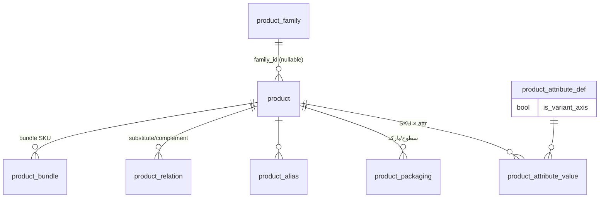

# طراحیِ هدفِ Product Master — پیش‌طراحیِ معماری (TASK-21R)

> وضعیت: **طرحِ پیشنهادی برای تأییدِ مالک** — هیچ کد/مهاجرتی در این وظیفه اجرا نمی‌شود.
> مرجعِ دامنه: `PRODUCT_ROADMAP.md` §6-A و §۸ (۱۴ بند) — **دامنه حذف یا باریک نمی‌شود**؛ این سند فقط نحوهٔ تحقق را معین می‌کند.
> پیوستگی: `IMPLEMENTATION_SEQUENCE.md` (فازِ P1) · `GAP_REGISTER.md` (شکاف‌های G-06/G-07/G-13/G-03) · `MODULE_INVENTORY.md` (C-01..C-12).

## ۰) نتیجهٔ آمادگی (دقیق) و تصمیماتِ واقعیِ مالک

| لایه | نتیجه |
|---|---|
| **معماری/طراحی** | **`READY`** — بنیادها راستی‌آزمایی شده، دامنه شناخته‌شده، همین سند مدلِ هدف را می‌بندد. |
| **پیاده‌سازی** | **`CONDITIONAL READY`** — بدونِ مانعِ خارجی؛ مشروط به (۱) تأییدِ همین طرح؛ (۲) چهار تصمیمِ سیاستِ کسب‌وکار زیر؛ (۳) سبز شدنِ بستهٔ تستِ رفتاریِ موتورِ تایید (G-03) **پیش از** سیم‌کشیِ «تغییراتِ حساس» به approval (پیش از آن، تغییراتِ حساس با RBAC + audit اداره می‌شوند). |

**تصمیماتِ واقعیِ نیازمندِ تأییدِ مالک** (فقط مواردِ سیاستِ کسب‌وکار — نه مسائلِ فنی که در حوزهٔ معماری بسته می‌شوند):

| # | تصمیم | گزینه‌ها | پیشنهادِ معمار |
|---|---|---|---|
| D-1 | تولیدِ SKU | دستی · خودکار (سریال) · هر دو | **هر دو** (کدِ دستی با اعتبارسنجیِ یکتا + پیشنهادِ خودکار برای import انبوه) |
| D-2 | سخت‌گیریِ تشخیصِ تکرار (نام/alias/بارکد/کد) | block · warn همراهِ ادامه | **block برای کد/بارکد؛ warn برای نام/alias** |
| D-3 | قاعدهٔ گردکردنِ تبدیلِ واحد | half-up · half-even · قطع (truncate) | **حفظِ دقیقِ ۴ رقمِ اعشار در تبدیل؛ گردکردن فقط در مرزِ نمایش/سند با half-up** — تغییری در قواعدِ گردکردنِ مالیِ موجود نمی‌دهد (قاعدهٔ ask#10) |
| D-4 | مرزِ «تغییرِ حساس» (نیازمندِ approval) | فهرستِ پیشنهادی زیر | **مالیات، وضعیت→discontinued، واحدِ پایه/فاکتورِ تبدیل، اجزای bundle** |

بقیهٔ مواردِ §۸ (attributes، variants، alias، تصویر، جایگزین/مکمل، import، snapshot) **طبقِ نقشهٔ راه الزامی‌اند** و تصمیمِ دامنه‌ای نمی‌خواهند — فقط semantics آن‌ها در این سند تعیین شده است.

---

## A. هویتِ محصول و کاتالوگ

| موضوع | تصمیمِ هدف | وضعیتِ امروز |
|---|---|---|
| دامنهٔ tenant | `product.company_id` حفظ می‌شود؛ SKU در `(company_id, code)` یکتا (موجود). دامنهٔ شعبه‌ای برای کاتالوگ **خارج از scope** (قیمت/موجودی شعبه‌ای است، نه تعریفِ کالا). | ✅ موجود |
| چرخهٔ SKU | `status ∈ {active, blocked, discontinued}` + `deleted_at` نرم؛ **حذفِ فیزیکی ممنوق وقتی ارجاعِ سند/موجودی/قیمت وجود دارد**؛ گذارِ blocked→active با مجوزِ `product.status`؛ discontinued برگشت‌پذیر نیست مگر با `product.status` (ممتاز). | ✅ موجود (قواعدِ گذار جدید) |
| نامِ فارسی/لاتین | `name` (فارسی، موجود) + `name_latin` (جدید، nullable) + `name_display` مشتق نشود — نمایش: فارسی، fallback لاتین. | 🟡 نیمه |
| alias و تشخیصِ تکرار | جدولِ جدید `product_alias(id, product_id, alias, alias_norm, kind ∈ {brand_slang, latin, code}, unique(product_id, alias_norm))` + GIN-trgm روی `alias_norm`؛ تشخیصِ تکرار هنگامِ create/import روی نرمال‌سازیِ (نام، alias، کد، بارکد) — طبقِ D-2. | ❌ جدید |
| گروه/برند | موجود (سلسله‌مراتبِ `parent_id` + `cost_method`) — بدونِ تغییر. | ✅ |
| attribute/variant | مدلِ §B. | ❌ جدید |
| تصویر/سند | بازاستفاده از `attachment.owner_type='product'` (زنجیرهٔ مالکیت موجود). قراردادِ تصویرِ اصلی = نخستین بر اساس `created_at` (بدونِ مهاجرت)؛ در صورتِ نیازِ UI، بعداً `sort_order` اضافه شود. | 🟡 API موجود، UX ندارد |
| جایگزین/مکمل | `product_relation(product_id, related_id, kind ∈ {substitute, complement}, priority, unique(product_id, related_id, kind))`؛ خودارجاع ممنوع؛ حلقه در سطحِ substitute در service رد می‌شود. | ❌ جدید |
| bundle | `product_bundle(bundle_product_id, component_product_id, qty)` — خودِ bundle یک ردیفِ `product` واقعی (SKU قابلِ فروش) است؛ در P1 **فروشِ bundle = یک خطِ سفارش روی SKU بسته** و **کسرِ موجودی اجزا در لحظهٔ postingِ موجودی (expansion)**؛ اگر expansion در P1 سنگین بود، گزینهٔ «bundle بدونِ اثرِ موجودیِ اجزا تا P5» صادقانه اعلام و در تخمین لحاظ شود (یکی از ماشه‌های M→L). | ❌ جدید |

## B. معماریِ Variant و SKU (تصمیمِ محوری)

### ارزیابی
- **صفتِ توصیفی (descriptive attribute):** ویژگیِ اطلاع‌رسان (رنگِ بسته، ارتفاع، نوعِ عرضه) که **قیمت/موجودی/مالیات/بارکد مستقل ندارد** — نباید SKU بسازد.
- **variant عملیاتی (operational variant):** ترکیبی که **قیمت، موجودی، بارکد یا مالیاتِ مستقل** دارد (مثلاً طعم/حجم) — در DMS مویرگی تقریباً همیشه صادق است ⇒ **هر variant عملیاتی = یک SKU مستقل**.

### مدلِ پیشنهادی: «SKU-per-variant با خانوادهٔ اختیاری»

- `product` **همچنان تنها هویتِ SKU است** (همهٔ FKهای موجود: `inventory_txn.product_id`، `sales_order_line.product_id`، `price_list_item.product_id`، `batch.product_id` — **بدونِ هیچ مهاجرتِ داده‌ای**).
- `product_family` = گروهِ اختیاری (مثلاً «شیر پرچرب ۱ لیتری»)؛ ستونِ `product.family_id nullable` — ردیف‌های موجود = SKUهای مستقلِ بدونِ خانواده (سازگاریِ کامل).
- `product_attribute_def(company_id, code, title, kind ∈ {text, number, enum}, is_variant_axis, is_required)` + `product_attribute_value(product_id, def_id, value_text/value_num/value_enum)`.
- **variant_signature**: هشِ مرتبِ مقادیرِ صفاتِ `is_variant_axis` در هر خانواده؛ `unique(family_id, variant_signature)` (partial) — تشخیصِ تکرارِ variant.
- **چه زمانی variant = SKU مستقل؟** همیشه وقتی یکی از {قیمت، موجودی، بارکد، مالیات، چرخهٔ مستقل} متفاوت باشد؛ برای صفاتِ صرفاً توصیفی، attribute کافی است و SKU اضافه ساخته نمی‌شود.
- **بارکد:** `uq_product_barcode` فعلی (یکتای جهانی روی `product_packaging.barcode`) **حفظ می‌شود** (بارکدهای GS1 عملاً جهانی‌اند)؛ چند بارکد برای یک SKU = چند ردیفِ packaging یا alias با kind='code' (طبقِ D-2 در بارکد block).
- **سطحِ قیمت/موجودی/مالیات/خطِ سفارش:** همه در **سطحِ SKU** (`product_id`) — هم‌راستا با schema موجود؛ قیمتِ سطحِ خانواده (اگر روزی لازم شد) فقط به‌صورتِ قاعدهٔ مشتق، نه منبعِ حقیقت.
- **سازگاریِ عقب‌رو:** هیچ داده‌ای جابه‌جا نمی‌شود؛ endpointهای فعلیِ product دست‌نمی‌خورند؛ همه چیز additive.

### جایگزین‌ها و trade-offها
| مدل | مزیت | هزینه/ریسک | داوری |
|---|---|---|---|
| **A. SKU-per-variant + خانواده (پیشنهادی)** | سازگار با تمامِ FKها؛ قیمت/موجودی/مالیات ساده و یکتا | تعدادِ ردیف‌های product بیشتر (قابلِ قبول) | ✅ |
| B. یک SKU + انتخابِ صفت روی خطِ سفارش | ردیفِ کمتر | **شکستنِ FKهای موجود**؛ موجودی/قیمت/مالیات per-combo پیچیده؛ کوئری‌های سنگین | ❌ |
| C. SKU-per-variant بدونِ خانواده | ساده‌ترین | نمایشِ ماتریسی/جست‌وجوی خانواده‌ای ناممکن | 🟡 (fallback اگر D-1 ساده خواسته شود) |

### پیامدهای مهاجرت/ایندکس
- جداولِ جدید: `product_alias`, `product_attribute_def`, `product_attribute_value`, `product_relation`, `product_bundle` (+ در صورتِ پذیرشِ مدلِ A، ستونِ `product.family_id` و `variant_signature`).
- ایندکس‌ها: GIN-trgm روی `alias_norm`؛ `unique(family_id, variant_signature)`؛ `unique(company_id, code)` موجود دست‌نخورده.
- حجم: جداولِ attribute در جدول‌های متعارفِ EAV-lite برای مقیاسِ هزار SKU (نه میلیونی) کافی‌اند؛ در صورتِ رشد، بعداً index tuning — نه اکنون.

## C. واحدها و بسته‌بندی

| موضوع | هدف |
|---|---|
| واحدِ پایه/جانشین | `uom` موجود + `product_packaging.factor_to_base numeric(19,4)` (موجود). واحدِ جانشین = همان سطوحِ packaging. |
| دقت و گردکردن | تبدیل با **نگه‌داشتنِ ۴ رقمِ اعشار** (بدونِ گردکردنِ میانی)؛ گردکردن فقط در مرزِ نمایش/سند (طبقِ D-3؛ نیم‌بالا). `qty_base` روی خطوطِ سند **همیشه مقدارِ نهاییِ ثبت‌شده است** و هرگز بازمحاسبه نمی‌شود. |
| سلسله‌مراتبِ بسته‌بندی | سطوحِ فعلی (مثلاً عدد/کارتن/پالت) با `is_sales_default`/`is_purchase_default` (موجود)؛ سقفِ منطقی: ۴ سطح در P1 (اعتبارسنجی در service). |
| بارکدِ مستقلِ بسته‌بندی | موجود (`uq_product_barcode`) + نمایش/جست‌وجوی بارکد در UI (اسکن). |
| یکپارچگیِ تاریخیِ تبدیل | خطوطِ سندِ جدید: `packaging_id` + ستونِ snapshotِ `packaging_factor` (جدید) + `qty_base` موجود؛ تغییرِ `factor_to_base` روی اسنادِ گذشته **بی‌اثر** است (تست می‌شود). |
| تعامل با انبار | postingِ موجودی همیشه به **واحدِ پایه**؛ قیمت‌گذاری: `price_list_item` **افزودنیِ `packaging_id` nullable** (NULL = واحدِ پایه؛ ردیف‌های موجود = رفتارِ فعلی) تا قیمتِ «هر بطری/هر کارتن» صریح شود. |
| تعامل با خرید | `is_purchase_default` + قیمتِ خریدِ سطحِ packaging (همان ستونِ nullable). |

## D. یکپارچگیِ تراکنشِ تاریخی (snapshot)

**قاعدهٔ طلایی (§۸):** تغییرِ نام/مالیات/واحد/قیمتِ فعلیِ محصول هرگز نباید حقایقِ اسنادِ تاییدشدهٔ گذشته را بی‌صدا بازنویسی کند.

| مورد | snapshot لازم؟ | امروز | هدف |
|---|---|---|---|
| نامِ محصول | ✅ | ❌ | ستونِ `product_name` روی خطوطِ سندِ تاییدشده |
| کدِ SKU/هویتِ variant | ✅ (کد + signature) | 🟡 (FK) | `product_code` + `variant_display` snapshot |
| عنوانِ واحد/فاکتورِ تبدیل | ✅ | 🟡 (`qty_base` فقط) | `uom_title` + `packaging_factor` snapshot |
| هویتِ بسته‌بندی/بارکد | ✅ | 🟡 (`packaging_id` FK) | `packaging_label` snapshot |
| صفاتِ مالیاتی | ✅ (نرخ + کد + شناسهٔ مؤدیان) | ✅ (`tax_rate_pct/tax_amount`) | + `tax_code` snapshot |
| قیمت/تخفیف | ✅ | ✅ (unit_price/discount_*) | حفظ |
| صفاتِ تجاریِ مرتبط | فقط در صورتِ اثر بر سند (مثلاً `distribution_kind` در تحویلِ سرد) | ❌ | فقط مواردِ اثرگذار، صریح و مستند |

**برخورد با داده‌های تاریخیِ موجود:**
- ستون‌های snapshot **nullable اضافه می‌شوند**؛ ردیف‌های قدیمی **NULL می‌مانند — هرگز backfill کور از دادهٔ فعلی انجام نمی‌شود** (ساختنِ تاریخ جعلی = ممنوع).
- UI برای snapshotهای NULL: نمایشِ دادهٔ فعلیِ کاتالوگ **با نشانِ «اطلاعات از کاتالوگِ فعلی»**؛ گزارش‌ها مشخص می‌کنند snapshot است یا فعلی.
- enforcement از نخستین سندِ تاییدشدهٔ پس از deploy: service لایه، snapshot را در لحظهٔ تایید می‌نویسد (تستِ واحدِ اختصاصی).

## E. import و عملیاتِ انبوه (حداقلِ امنِ CSV برای محصول)

> مرکزِ import/export عمومی (G-13) **ظرفیتِ آیندهٔ مستقل** می‌ماند؛ اینجا فقط «import محصول» با همان الگوی استاندارد پیاده می‌شود.

1. **آپلود** (`POST /products/import/validate`): CSV با هدرِ فارسی/انگلیسیِ مستند؛ سقفِ P1: ≤۱۰٬۰۰۰ ردیف/فایل، ≤۱ مگابایت.
2. **اعتبارسنجی و پیش‌نمایش:** نوع/الزامی‌ها، حلِ FK با `code` (گروه/برند/واحد/مالیات)، تشخیصِ تکرار (درون‌فایل + بانک، طبقِ D-2)، گزارشِ فارسیِ ردیف‌به‌ردیف (بدونِ اجرای نوشتن).
3. **تأیید** (`POST /products/import/commit`): مجوزِ `product.import` + audit؛ بدنه شاملِ `idempotency_key` (hash محتوا + توکنِ کلاینت).
4. **اجرا:** job درونِ BullMQ با دسته‌های ۱۰۰تایی؛ **همه‌یاهیچ در هر دسته**؛ خرابیِ جزئی ⇒ گزارشِ خطا (artifact ضمیمه) + ادامهٔ دسته‌های بعدی؛ تکرارِ همان `idempotency_key` ⇒ بدونِ اثرِ دوباره (upsert صریح بر `(company_id, code)` با mode صریح `create|update`).
5. **جداسازیِ tenant:** `company_id` فقط از session — **هرگز از CSV** (قاعدهٔ TASK-14).
6. **audit:** هر create/update با before/after در `audit_log`؛ خطاهای حساس بدونِ مقدارِ رمز/داده در پیام.

## F. مجوزها و تاییدها (حلِ وابستگیِ G-03)

| عملیات | کنترل |
|---|---|
| create/edit فیلدهای عادی، alias، تصویر، packaging | **RBAC عادی** (`product.create/update` — موجود) |
| تغییرِ مالیات · status→discontinued · واحدِ پایه/فاکتورِ تبدیل · اجزای bundle | **approval** (طبقِ D-4) — پس از سبز شدنِ بستهٔ G-03 |
| import انبوه | `product.import` + در صورتِ فعال بودنِ approval: modeِ «تاییدِ گروهیِ ردیف‌های حساس» |
| مشاهده/قیمت | مجوزهای جدا (`price.*` — موجود) |

**پیش‌نیازِ G-03 (غیرقابلِ چشم‌پوشی برای سیم‌کشیِ approval):** بستهٔ تستِ رفتاریِ ≥۱۵ سناریو — گذارِ وضعیت (submit/approve/reject/withdraw)، زنجیرهٔ چندمرحله‌ای، آستانه‌ها، جداسازیِ tenant، idempotencyِ تصمیم، چکِ مجوز در هر گذار، برخوردِ تصمیمِ تکراری. **اگر تست‌ها نقصِ engine را نشان دادند:** رفعِ حداقلِ مجاز در همان فاز (با گزارش)، نه دور زدنِ engine. **تا سبز شدنِ بسته:** تغییراتِ حساس = RBAC + تأییدِ دومرحله‌ایِ داخلی (confirm صریح) + audit — بدونِ وابستگی به engine.

## G. اثراتِ یکپارچگی و رگرسیون

| مصرف‌کننده | اثر | سازگاری |
|---|---|---|
| قیمت/تخفیف | `price_list_item.packaging_id` nullable؛ موتورِ قیمت SKU-level | افزودنی؛ رفتارِ فعلی برای NULL حفظ |
| سفارش/فاکتور | ستون‌های snapshot در خطوط؛ منطقِ قیمت/مالیات تغییر نمی‌کند | افزودنی؛ تستِ عدمِ بازنویسیِ تاریخ |
| موجودی/بچ/انبار | بدونِ تغییرِ ساختار (SKU-level)؛ expansionِ bundle در posting | فقط bundle جدید |
| خرید/دریافت | همان SKU-level + snapshot در خطوطِ خرید (همان الگو) | افزودنی |
| مرجوعی | ارجاع به SKU + snapshot همانندِ فروش | افزودنی |
| مالی/گزارش | نمایشِ نامِ snapshot در گزارش‌ها؛ `account_mapping`/COGS دست‌نخورده | سازگار |
| وب | endpointهای additive (attributes/aliases/relations/import) + صفحاتِ جدید | قرارداد نسخه‌دار؛ `contract-drift` سبز |
| اندروید | بازتولیدِ کلاینتِ Kotlin (`npm run clients:generate`) | additive — شکستِ API ندارد |

**رگرسیونِ اجباری:** همهٔ تست‌های موجود سبز بمانند · تستِ جدیدِ snapshot immutability · تستِ قیمت با `packaging_id` · تستِ import (idempotency/tenant) · تستِ بستهٔ G-03 · خروجیِ openapi:check/clients.

## H. UX فارسی‌نخست

- **فهرست/جست‌وجو:** جست‌وجوی فارسی/لاتین/بارکد (trgm) + اسکنِ بارکد؛ نتایج با نامِ فارسی و کدِ LTR در ``؛ صفحه‌بندی.
- **فرمِ ایجاد/ویرایش (RTL):** گام‌های «شناسه · نام‌ها و alias · ویژگی‌ها · بسته‌بندی/بارکد · مالیات · تصاویر»؛ اعتبارسنجیِ فارسی با نامِ فیلد؛ پیامِ خطای قرارداد (کدهای `exercisedErrors`) به فارسی.
- **ماتریسِ variant:** ویرایشگرِ جدولیِ خانواده × صفاتِ محوری؛ ایجادِ گروهیِ SKU؛ هشدارِ تکرارِ inline (طبقِ D-2).
- **تاریخ‌ها:** نمایشِ Jalali برای اعتبار/audit (کتابخانهٔ موجودِ persian-date)؛ ورودیِ تاریخ با تقویمِ شمسی.
- **import:** جادوگرِ «آپلود → پیش‌نمایش (خطاها به فارسی) → تأیید → پیشرفت → گزارش».
- **دسترس‌پذیری:** label/aria برای فیلدها، focus-ring موجود، پیام‌های خطای نزدیکِ فیلد، بدونِ رنگِ تنها به‌عنوانِ نشانه.
