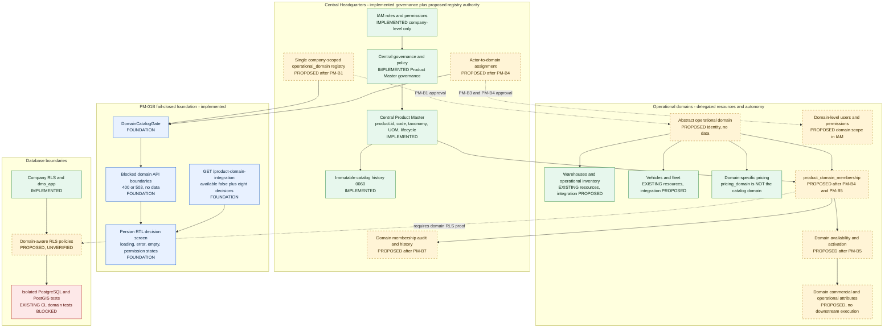
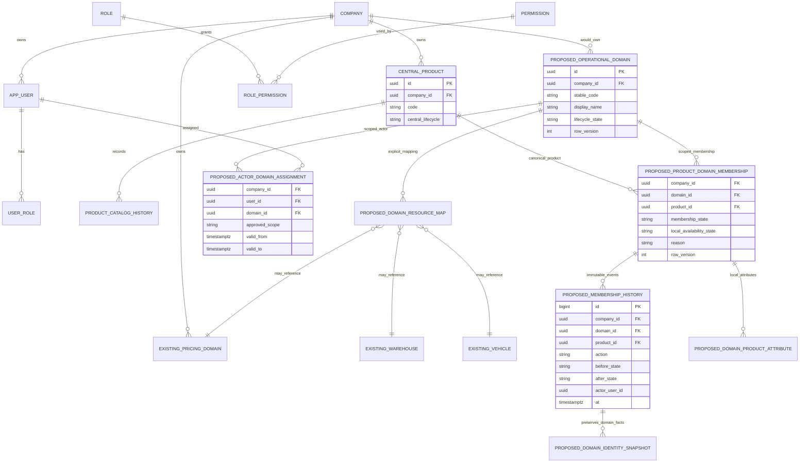
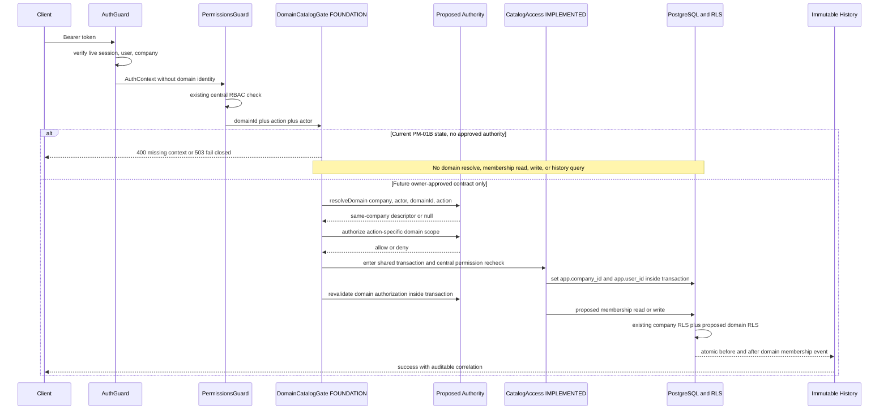
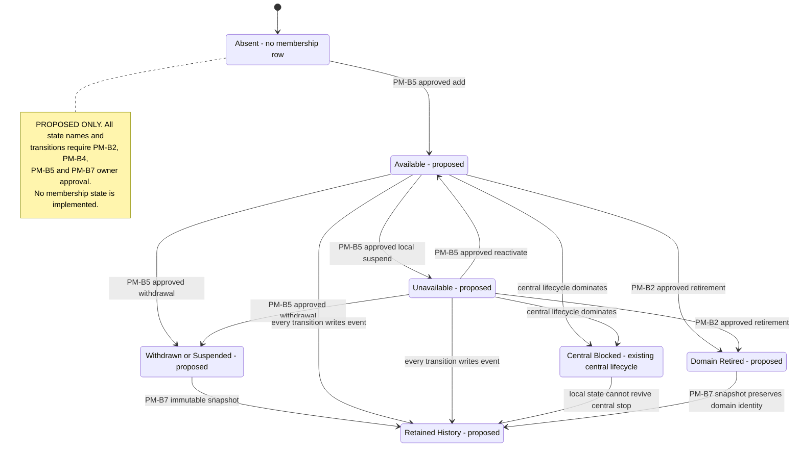

# TASK-PM-01C — Operational Domain Architecture

**Status: PROPOSED / OWNER-REVIEWABLE.** PM-B1 through PM-B8 remain **OPEN / NOT APPROVED**. This document contains no approved business policy, no signatory, no domain data, and no executable domain registry. It does not change PR #14's fail-closed implementation.

Baseline verified: PR #14 head `19b7611cb8ce5534709245486e48b4814deb5bd0`; base merge commit `6b4429ba7e55f7e02f407e63f2b2b2e197fad1fa`. PM-01A final implementation `eb23347421d00525e72d57766bf0ef5fc288f9af`. Branch `arena/be5eaff3-green-dms` remains `pr_open`. No merge/deploy/protected-branch/production/shared-DB change is authorized.

> خلاصه فارسی برای مالک: این سند فقط یک «معماری هدف قابلبررسی» ارائه میکند. ستاد مرکزی مالک حاکمیت، سیاستها، نظارت و تصمیمهای صریحاً محفوظ است؛ دامنههای عملیاتی بر منابع واگذارشده خود از جمله انبارها، ناوگان، قیمتگذاری دامنهای، کاربران/مجوزهای دامنهای و موجودی عملیاتی اختیار دارند. هویت جهانی کالا، عضویت کالا در دامنه، فعال/در دسترس بودن محلی و صفات تجاری/عملیاتی دامنهای چهار لایه جدا هستند. وجود یا فعال بودن مرکزی بهمعنی عرضه در همه دامنهها نیست. هیچ جدول، مجوز، شناسه دامنه یا جریان کاری تا تصمیم مالک پیادهسازی نمیشود. بسته تصمیم کامل در `TASK-PM-01C_OWNER_DECISION_PACKAGE.md` است.

## 1. Evidence boundary and status legend

Legend used in every diagram and matrix:

| Marker | Meaning |
|---|---|
| **IMPLEMENTED** | Existing code/database/API/UI on the verified PM-01B SHA. |
| **FOUNDATION** | Existing PM-01B fail-closed technical boundary; no business semantics. |
| **PROPOSED** | Target-state component requiring one or more PM-B decisions; not built. |
| **BLOCKED** | Cannot be implemented or activated until explicit owner approval evidence exists. |
| **UNVERIFIED** | No executable/mapping/visual/independent-review evidence available. |

### Verified implemented baseline

- `product.id` and `product.company_id` remain the sole central SKU/company identity; existing `0046`/`0047` Product Master tables and RLS remain intact.
- PM-01A delivered DB-resolved service write authorization through `CatalogAccess`, shared transactions/tenant GUCs, immutable `0060` catalog history, and connected Persian RTL Product Master screens.
- PM-01B delivered `DomainCatalogGate`, an **unregistered** `OPERATIONAL_DOMAIN_AUTHORITY` symbol, fail-closed read/write endpoints, missing-context 400 handling, OpenAPI/client documentation, a Persian RTL decision/blocked-state page, and DB-free tests.
- `MasterDataModule` registers `DomainCatalogGate` only; it does **not** register `OPERATIONAL_DOMAIN_AUTHORITY`. A static PM-01B test asserts this.
- `AuthContext` contains `userId`, `sessionId`, `companyId`, `username`, `roles`, `permissions`; no domain identity or actor-to-domain assignment exists.
- `0041` provides fail-closed `fn_current_company_id()` and runtime roles; `0047` provides company-level Product Master RLS. No domain-level RLS table/policy exists.
- `pricing_domain` from `0049` is a pricing-policy scope (`channel`/`area`/`branch`); approval `domain_id` columns from `0053` are untyped UUIDs. Neither is authoritative for product-catalog domains.
- No `product_domain_*`, `operational_domain`, `actor_domain_assignment`, domain-scoped permission, migration or workflow exists.

### Explicitly not changed by PM-01C

- No migration or rollback file.
- No `.github` workflow change.
- No code, OpenAPI, generated client, permission seed, RLS policy, grant or DB connection.
- No registry row, domain ID, sample domain, sample product, fabricated owner, signatory or approval record.

## 2. Preserved organizational principles

1. **Central Headquarters:** owns organization-wide governance, policies, oversight and decisions explicitly reserved for central authority. Central ownership of global product identity does **not** imply unrestricted operational control over domain resources.
2. **Operational Domains:** retain delegated autonomy over their own operational resources and activities, including warehouses, vehicles/fleet, domain-specific pricing, domain-level users/permissions, operational inventory and other delegated resources. Integration of those resources into Product Master requires owner-approved mappings; no implicit equivalence is assumed.
3. **Four-layer product model:**
   - L1 global product identity and product master information;
   - L2 product membership in an operational domain;
   - L3 product availability/activation within that domain;
   - L4 domain-specific commercial/operational attributes.
4. **No universal fan-out:** a product may be active in one domain and absent or unavailable in another. No membership row means absent, not implicitly available.
5. **Central lifecycle dominance:** local availability cannot revive a centrally blocked/discontinued/deleted product. Exact transition semantics remain a PM-B5/PM-B2 decision.
6. **Single source of truth:** if PM-B1 approves a dedicated company-scoped `operational_domain` identity, it must be the single authoritative registry. It is not a parallel registry and must not repurpose `pricing_domain`, branch, area, warehouse, company, label or approval UUIDs.
7. **Fail closed:** preserve PM-01B's `available:false`/503 behavior until an approved authority provider, membership persistence, IAM vocabulary, privacy rules and executable tests exist.

## 3. Target-state architecture

### 3.1 Mermaid architecture diagram

Standalone source: `TASK-PM-01C_ARCHITECTURE_DIAGRAM.mmd`.

### 3.2 Entity relationship diagram

Standalone source: `TASK-PM-01C_ER_DIAGRAM.mmd`.

**Important:** every `PROPOSED_*` entity is conceptual only. No SQL DDL, FK, uniqueness, index, RLS policy or grant was created. Naming is illustrative for owner review, not approved schema.

### 3.3 Authorization flow

Standalone source: `TASK-PM-01C_AUTH_FLOW.mmd`.

No domain-level authority provider is registered. The "future" branch is a target-state requirement, not executable behavior.

### 3.4 Proposed product membership lifecycle

Standalone source: `TASK-PM-01C_MEMBERSHIP_LIFECYCLE.mmd`.

## 4. Central-versus-domain responsibility matrix

This matrix preserves the mission's organizational model. "Recommended" entries are **not approvals**.

| Capability | Central Headquarters | Operational Domain | Shared / approval gate | Current implementation |
|---|---|---|---|---|
| Global product identity, SKU/code, taxonomy, UOM, tax/compliance flags | Owns and governs | Reads as authorized; no local clone | D1–D5 unchanged | IMPLEMENTED |
| Central product lifecycle active/blocked/discontinued/deleted | Owns | Cannot override | Sensitive-change D4 preserved | IMPLEMENTED |
| Immutable central catalog history | Owns and audits | May receive approved privacy-filtered view | PM-B8 decides cross-domain visibility | IMPLEMENTED for central catalog |
| Warehouses, vehicles/fleet, operational inventory | Policy/oversight | Delegated operational autonomy | Explicit resource mapping needs PM-B1/PM-B4 | EXISTING resources; Product Master integration PROPOSED |
| Domain-specific pricing | Policy/oversight | Delegated autonomy | `pricing_domain` is not catalog identity | EXISTING pricing module; no PM execution here |
| Domain-level users and permissions | IAM standards/security | Delegated assignment within approved scope | PM-B3/PM-B4/IAM approval | Company-level IAM IMPLEMENTED; domain scope PROPOSED |
| Authoritative domain registry and lifecycle | Recommended central governance of single registry | Uses stable IDs; no local parallel registry | PM-B1/PM-B2 approval | BLOCKED |
| Actor-to-domain assignment | IAM/security policy | Domain-scoped assignment | PM-B4 approval | BLOCKED |
| Product membership add/remove/deactivate | Central authority if explicitly reserved; otherwise oversight | Local management if approved | PM-B4/PM-B5 approval | PM-01B fail-closed only |
| Domain availability/activation | Cannot be inferred from central active | Local state within approved boundaries | PM-B5 approval; central stop dominates | BLOCKED |
| Domain-specific commercial/operational attributes | Catalog invariants | Local attributes if approved | PM-B5/PM-B8 privacy approval | PROPOSED; no downstream execution |
| Cross-domain history/detail visibility | Central oversight role if approved | Own-domain visibility by default | PM-B8 approval | BLOCKED |
| Domain retirement/history retention | Governance/data-retention policy | Domain operational transition | PM-B2/PM-B7 approval | BLOCKED |
| DB company RLS and runtime role | Existing platform control | Uses same boundary | No weakening allowed | IMPLEMENTED and previously CI-tested |
| DB domain RLS | Security-approved migration | Domain-scoped rows | PM-B1/B3/B4 approval plus native tests | PROPOSED / UNVERIFIED |

## 5. Proposed API contract changes, if owner decisions are approved

Current PM-01B OpenAPI contains **194 paths / 277 operations / 137 schemas / 3 webhooks** and all domain endpoints are fail-closed. PM-01C changes no contract.

| Existing PM-01B route | Current behavior | Proposed future contract activation | Required decisions |
|---|---|---|---|
| `GET /product-domain-integration` | `200 available:false` with eight decisions and technical prerequisites | `available:true` only after approved provider **and** membership persistence are both registered and tested | PM-B1–PM-B8 |
| `GET /products/{id}/domain-catalog` | 503 with no data | Retire or redirect to approved membership endpoints; never imply universal availability | PM-B6/PM-B8 |
| `GET /operational-domains` | 503 | 200 with approved list/search fields, privacy filtering and pagination | PM-B1/PM-B2/PM-B3 |
| `GET /operational-domains/current` | 400 missing context or 503 | 200 with server-resolved same-company descriptor | PM-B1/PM-B3/PM-B4 |
| `GET /operational-domains/{domainId}/products` | 503 | 200 with domain membership and local availability; absent products handled per PM-B6 | PM-B3/PM-B5/PM-B6 |
| `POST /operational-domains/{domainId}/products` | 503 before write | Approved create membership with canonical product reference, reason and optimistic concurrency | PM-B4/PM-B5 |
| `PATCH /operational-domains/{domainId}/products/{productId}` | 503 before write | Approved domain-level status/availability transition | PM-B2/PM-B4/PM-B5 |
| `DELETE /operational-domains/{domainId}/products/{productId}` | 503 before write | Approved explicit withdrawal; history retained | PM-B5/PM-B7 |
| `GET /products/{id}/domain-membership` | 503 | 200 for authorized domain/central role with explicit absent/unavailable distinction | PM-B3/PM-B6/PM-B8 |
| `GET /products/{id}/domain-membership/history` | 503 | 200 with immutable history and domain identity snapshot | PM-B7/PM-B8 |
| New `/operational-domains/{domainId}/candidate-products` | Not implemented | Browse not-yet-registered central products under approved privacy rules | PM-B6 |
| New `/operational-domains/{domainId}/membership-history` | Not implemented | Domain-scoped immutable history with retirement-safe identity | PM-B7/PM-B8 |
| New domain registry and actor-assignment admin APIs | Not implemented | Central/IAM administration only after vocabulary and authority matrix approval | PM-B1/PM-B2/PM-B3/PM-B4 |

No proposed permission code is specified here. IAM/security must approve exact permission names, wildcard rules, assignment semantics, revocation/expiry and delegated administration.

## 6. Security and data-integrity boundary summary

Detailed requirements are in `TASK-PM-01C_SECURITY_MODEL.md`. Non-negotiable rules:

- Authentication and company isolation come from verified session/company context, not caller-supplied company IDs.
- Domain identity must be resolved server-side; a path/header UUID is not identity.
- Actor-to-domain assignment must be explicit, company-scoped, revocable and action-specific.
- Read, write and history endpoints each need authorization; company-level view permission is not sufficient for domain data.
- Every relevant service write boundary must recheck authorization inside the shared transaction before any mutation.
- Existing `dms_app` company RLS remains. Domain RLS requires an approved registry/migration and native runtime-role evidence; no DB-level domain enforcement is claimed today.
- Membership history must preserve a domain identity snapshot so retirement/rename/remapping cannot rewrite historical meaning.
- Domain retirement, central deactivation and product deactivation must not delete history.
- No broad grants, RLS weakening, `security definer` shortcut, fake role mapping or client-trusted domain claim is allowed.

## 7. Readiness statement

This architecture package is **PASS WITH FINDINGS** as documentation: it is internally consistent with the implemented fail-closed baseline and makes all eight decisions owner-reviewable. It is **PARTIAL PASS** for implementation readiness because technical prerequisites are identified, but **BLOCKED** for domain registry, IAM vocabulary, membership persistence, lifecycle workflows and consumer activation. Domain-level RLS/history/concurrency evidence is **UNVERIFIED** because no approved schema or executable tests exist. Overall Product Master business acceptance remains **BLOCKED**.
