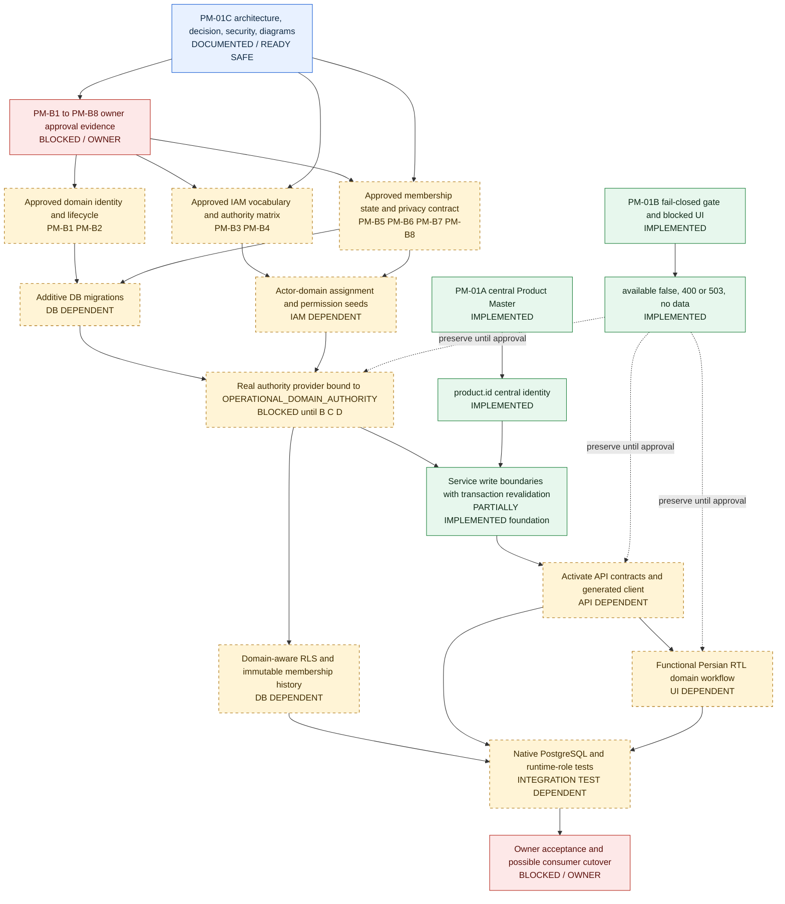

# TASK-PM-01C — Implementation Readiness and Dependency Matrix

**Status:** architecture/governance package only. PM-B1–PM-B8 remain **OPEN / NOT APPROVED**. PM-01B fail-closed behavior is preserved. No PM-01C source, migration, workflow, permission, API activation or test-suite rerun was performed.

Baseline: PR #14 head `19b7611cb8ce5534709245486e48b4814deb5bd0`; original base `6b4429ba7e55f7e02f407e63f2b2b2e197fad1fa`; PM-01A final `eb23347421d00525e72d57766bf0ef5fc288f9af`. Branch `arena/be5eaff3-green-dms`, status `pr_open`.

> خلاصه فارسی: نقشه وابستگی نشان میدهد چه چیزی پیادهسازی شده، چه چیزی فقط مستندسازی/آمادگی است، و چه چیزی دقیقاً به تصمیم مالک، IAM، مهاجرت، API/UI و تست یکپارچگی وابسته است. تا تصمیمها تأیید نشوند، هیچ عضویت یا چرخه حیات دامنهای ساخته نمیشود و مسیرها بسته میمانند.

## 1. Status legend

| Status | Meaning |
|---|---|
| **IMPLEMENTED** | Live on the verified PM-01B SHA. |
| **DOCUMENTED** | PM-01C architecture/decision evidence; no runtime change. |
| **READY / SAFE** | Can continue without inventing business policy; currently documentation and consistency work only. |
| **BLOCKED / OWNER** | Requires explicit PM-B approval evidence. |
| **IAM DEPENDENT** | Requires approved permission vocabulary, actor assignment, delegation/revocation semantics. |
| **DB DEPENDENT** | Requires additive migration, FK/uniqueness/index, RLS, runtime-role and up/down/up tests. |
| **API / UI DEPENDENT** | Requires contract, generated client and Persian RTL screens after approval. |
| **INTEGRATION TEST DEPENDENT** | Requires isolated disposable PostgreSQL/PostGIS, API/E2E and runtime-role evidence. |
| **UNVERIFIED** | No executable/visual/independent-review evidence. |

## 2. Dependency graph

## 3. Already implemented in PM-01A and PM-01B

| Capability | Source/evidence | Status | Notes |
|---|---|---|---|
| Central product CRUD, SKU/code uniqueness, variants, aliases, attributes, barcodes, packaging, bundles, relations | `0046`, Product Master services/repositories/controllers | IMPLEMENTED | D1–D5 preserved |
| Service write authorization, DB-resolved permissions, company/actor checks, shared transaction, nested operation isolation | `CatalogAccess`, PM-01A tests | IMPLEMENTED | No caller-trusted permission arrays |
| Atomic immutable central catalog history | `0060`, `product_catalog_history`, detail UI | IMPLEMENTED | Select-only runtime grant; company RLS |
| Company RLS/runtime role/GUC fail-closed | `0041`, `0047`, tenant interceptor/pool | IMPLEMENTED | Previously native CI tested |
| Permission-aware Persian RTL central Product Master UI | product list/new/import/detail/settings | IMPLEMENTED | Manual visual/a11y proof UNVERIFIED |
| Operational-domain absence evidence | PM-01A/PM-01B implementation docs | IMPLEMENTED | No authority model found |
| Eight OPEN owner decisions | `TASK-PM-01B_DOMAIN_OWNER_DECISIONS.md` | IMPLEMENTED | All OPEN / not approved |
| Narrow provider interface + `DomainCatalogGate` | `domain-catalog.contract.ts` | FOUNDATION IMPLEMENTED | No provider registered |
| Fail-closed read/write API boundaries | `catalog-foundation.controller.ts`, OpenAPI, client | FOUNDATION IMPLEMENTED | 400 missing context, 503 no authority |
| Blocked-state Persian RTL decision screen | `/products/domain-integration` | FOUNDATION IMPLEMENTED | No fake data |
| API and UI tests for fail-closed foundations | `domain-catalog-foundation.test.ts`, `page.test.tsx`, catalog evidence | IMPLEMENTED | PM-01B final CI 8/8 and native 47/1029 |

## 4. Readiness and blockers

| Work item | Current status | Owner gate | IAM | DB migration | API | UI | Integration tests |
|---|---|---|---|---|---|---|---|
| PM-01C architecture/decision/security/diagrams | DOCUMENTED / READY SAFE | none for docs | no | no | no | no | no |
| Keep all domain endpoints fail-closed | READY SAFE / preserved | none | no | no | no | no | no |
| Decision-ready PM-B1–PM-B8 proposals | DOCUMENTED / READY SAFE | review only | no | no | no | no | no |
| Dedicated domain registry | BLOCKED / OWNER | PM-B1 | yes for admin rights | yes | yes | yes | yes |
| Domain lifecycle state machine | BLOCKED / OWNER | PM-B2 | yes | yes | yes | yes | yes |
| Domain list/search permissions | BLOCKED / OWNER | PM-B3 | yes | maybe | yes | yes | yes |
| Actor-to-domain assignment and authority matrix | BLOCKED / OWNER | PM-B4 | yes | yes | maybe | yes | yes |
| Membership table and duplicate/unique constraints | BLOCKED / OWNER | PM-B1/B4/B5 | yes | yes | yes | yes | yes |
| Membership lifecycle and local availability | BLOCKED / OWNER | PM-B2/B4/B5 | yes | yes | yes | yes | yes |
| Not-yet-registered product visibility | BLOCKED / OWNER | PM-B6 | yes | no | yes | yes | yes |
| Domain identity snapshot/history retention | BLOCKED / OWNER | PM-B2/B7 | yes for history | yes | yes | yes | yes |
| Cross-domain detail/history visibility | BLOCKED / OWNER | PM-B8 | yes | maybe | yes | yes | yes |
| Domain-aware RLS/runtime-role grants | BLOCKED / OWNER | PM-B1/B3/B4/B7 | yes | yes | no | no | yes |
| Functional domain selector and status controls | BLOCKED / OWNER | PM-B3/B4/B5/B6/B8 | yes | no | yes | yes | yes |
| Downstream consumer integration | OUT OF SCOPE / BLOCKED | separate module/process owners | yes | maybe | yes | yes | yes |
| Isolated PG membership/concurrency/rollback/retention tests | BLOCKED / UNVERIFIED | all relevant PM-B decisions | yes | yes | yes | yes | yes |
| Independent QA/manual visual/RTL/a11y proof | UNVERIFIED | delivery gate if required | no | no | no | yes | optional |

## 5. Explicit non-work for PM-01C

- No `operational_domain`, `product_domain_membership`, actor assignment or membership history table.
- No domain-scoped permission code or role seed.
- No lifecycle transition, domain status, reason or availability state implementation.
- No new OpenAPI route activation, schema generation or client regeneration.
- No functional domain selector, add/change/remove UI or fake data.
- No change to migrations `0001`–`0060`, RLS policies, grants, workflows or central Product Master code.
- No unnecessary migration, full CI repeat, independent QA repeat or expensive unrelated audit.

## 6. Exact next implementation task

**TASK-PM-01D — Owner-approved domain authority contract and implementation readiness gate.**

Prerequisite: a signed owner decision record for PM-B1–PM-B8, including chosen alternatives, examples, IAM/security approval, privacy matrix, migration/backfill policy and acceptance criteria. No named signatory is invented here.

Only after that prerequisite:

1. Record the approval evidence and update PM-B1–PM-B8 status from OPEN to approved with exact references; otherwise keep fail-closed.
2. Have IAM/security approve exact permission names, wildcard rules, actor-domain assignment source, revocation/expiry and delegation semantics.
3. Design additive migrations for one authoritative company-scoped domain registry, actor assignments, membership, immutable membership history with domain identity snapshots, same-company FKs, uniqueness, indexes and domain-aware RLS. Do not edit historical migrations; provide up/down.
4. Bind an owner-approved `OPERATIONAL_DOMAIN_AUTHORITY` implementation; preserve `product.id` as the sole central SKU. Ensure provider resolution and action-specific authorization before all reads/writes, with revalidation inside `CatalogAccess.write`.
5. Replace only approved 503 boundaries with real API behavior and regenerate OpenAPI/client; add candidate-product and cross-domain history endpoints only if PM-B6/B8 approve them.
6. Convert the Persian RTL blocked screen into a functional workflow with permission/validation/loading/empty/error/stale states, no fabricated data, clear central-vs-domain distinction and responsive RTL layout.
7. Run isolated disposable PostgreSQL/PostGIS native tests: two domains sharing a central product; available in A/absent or unavailable in B; duplicate prevention; unauthorized cross-domain/cross-company; missing context; deactivation/historical retention; history integrity; concurrent changes; runtime-role RLS; migration up/down/up; API contract and UI behavior.
8. Keep downstream inventory, procurement, sales, distribution, warehouse and domain-specific pricing execution outside the task until separate owner/module gates.
9. Preserve PR #14 evidence, do not merge/deploy without explicit authorization, and report exact final SHA and verdicts.

## 7. Readiness verdicts

- PM-01A/PM-01B implementation preservation: **PASS**.
- PM-01C architecture/decision/dependency documentation: **PASS WITH FINDINGS**.
- Implementation readiness: **PARTIAL PASS** — dependencies and exact next task are defined, but no business approval exists.
- Domain registry, IAM vocabulary, membership persistence, lifecycle workflow and consumer activation: **BLOCKED**.
- Domain-specific DB/RLS/concurrency/history executable evidence: **UNVERIFIED**.
- Overall Product Master business acceptance: **BLOCKED**.
